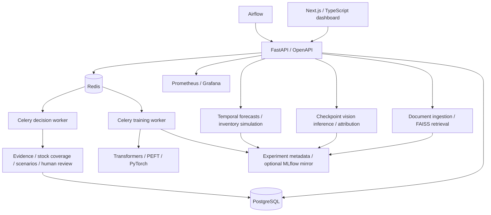
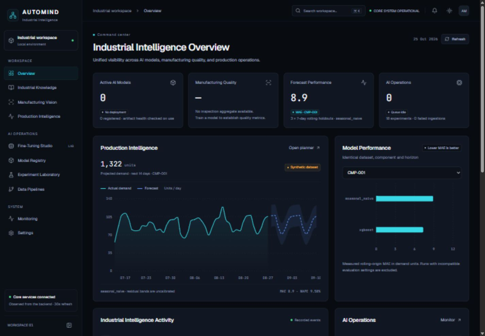

# AutoMind AI

**Industrial Intelligence & Model Optimization Platform**

A local-first application connecting document knowledge, visual quality inspection, and production planning. It uses public-model integrations and reproducible synthetic production data. It is independent of all automotive manufacturers and contains no proprietary industrial data.



The main application works without paid API keys or a GPU. Large model downloads and training are explicit operations. Default document answers are **cited verbatim excerpts**, using a labelled lexical hashing baseline with FAISS; configure sentence transformers and a local open-weight LLM for semantic generative RAG. No trained vision model ships with this repository.

## Start on Windows

Install Docker Desktop with its WSL2 Linux engine and start it. From the repository root in PowerShell:

```powershell
powershell -ExecutionPolicy Bypass -File scripts/init-env.ps1
docker compose up --build -d
docker compose ps
Invoke-RestMethod http://localhost:8000/health/ready
```

Open [dashboard](http://localhost:3000) and [interactive API documentation](http://localhost:8000/docs). The init script generates local credentials in ignored `.env`, preserving any existing file. See [SETUP.md](SETUP.md) for native Python/Node development, full services and GPU profiles.

In the verified local workspace, occupied host ports required `.env` overrides: use the [running dashboard](http://localhost:13000) and [API documentation](http://localhost:18000/docs). PostgreSQL and Redis use loopback ports 15432 and 16379. Fresh installations retain the defaults above unless overridden.

## Try the working workflows

**Decision Intelligence:** open [the local command center](http://localhost:13000/decision-intelligence) to connect quality reports, cited knowledge, stock coverage, editable scenario comparisons and authenticated review. Use the labelled synthetic demo for local testing. See [Decision Intelligence documentation](docs/DECISION_INTELLIGENCE.md) for setup, reviewer credentials, APIs, assumptions and limits. Approval records a local decision without executing production changes.

1. **Industrial Knowledge:** upload `datasets/samples/maintenance.md`, ask about the fictional ALPHA-7 inspection interval, inspect source citations, and delete the document. The handbook is fictional and unsuitable for operating real machinery.
2. **Production Intelligence:** generate seed-42 synthetic data, select a component, run seasonal naive or CPU XGBoost forecasting, inspect rolling-origin metrics, and simulate a reorder policy. All displayed values come from actual computations. SHAP is optional; the default explanation is labelled feature gain.
3. **Manufacturing Vision:** the page clearly reports the missing-checkpoint state until a real model is trained and activated. Training supports ResNet-50, EfficientNet-B0 and ViT. CNN Grad-CAM and ViT patch-token gradient attribution are labelled separately.
4. **Fine-Tuning Studio:** submit versioned YAML configurations to a Celery worker when training is enabled. Observe job states, failure details, results and cooperative cancellation.
5. **Experiments and pipelines:** inspect persisted evaluation records, model lifecycle states, dataset checksums and ingestion quality reports. Compare compatible dataset/configuration runs only.

## Technology

Next.js, React, TypeScript, Tailwind, shadcn-style Radix button, Recharts, TanStack Query, React Hook Form and Zod; FastAPI, Pydantic, SQLAlchemy, Alembic, PostgreSQL, Redis and Celery; FAISS, Pandera, NumPy, Pandas, scikit-learn; optional Transformers, PEFT, TRL, PyTorch, torchvision, XGBoost, SHAP and MLflow; Airflow, Docker, Prometheus, Grafana and GitHub Actions.

## Test and reproduce

After the native installation in SETUP.md:

```powershell
python -m pytest -q
python -m ruff check apps/api tests pipelines scripts
python -m mypy
python scripts/benchmark_production.py --models seasonal_naive xgboost
python scripts/evaluate_knowledge.py --retrieval-only
python scripts/train.py experiments/configurations/lora-cpu.yaml
```

The last command downloads the explicitly allowlisted model and performs real CPU LoRA training; it is optional and potentially slow. Never run it as an application startup hook. [MODEL_TRAINING.md](MODEL_TRAINING.md) explains datasets, model licensing and configurations. [EVALUATION.md](EVALUATION.md) documents measured metrics and the manual LLM rubric.

## Screenshots

The Obsidian Intelligence interface has locally served Geist/JetBrains Mono fonts, persisted dark/light/system themes, collapsible navigation, keyboard command search, eleven operational views, inspectors, and real empty/error states. Backend APIs and model-training logic are preserved. Verified redesign screenshots are stored in `docs/screenshots/obsidian/`; the new command center is documented in `docs/screenshots/decision-intelligence/`.


 See [IMPLEMENTATION_STATUS.md](IMPLEMENTATION_STATUS.md) for the exact checks actually executed in the development environment.

## Documentation

- [Architecture and module boundaries](ARCHITECTURE.md)
- [PowerShell setup and profiles](SETUP.md)
- [REST API](API.md)
- [Datasets and licensing](DATASETS.md)
- [Training and checkpoints](MODEL_TRAINING.md)
- [Evaluation methodology](EVALUATION.md)
- [Security and deployment boundaries](SECURITY.md)
- [Troubleshooting](TROUBLESHOOTING.md)
- [Technical research report](docs/research/REPORT.md)
- [Implementation status and actual verification](IMPLEMENTATION_STATUS.md)
- [UI redesign plan and browser verification](UI_REDESIGN_PLAN.md)
- [Decision Intelligence architecture, APIs, assumptions and verification](docs/DECISION_INTELLIGENCE.md)

## Current limits and next work

This is a local portfolio system, not a validated industrial control product. No industrial model accuracy, enterprise reliability, real savings or GPU training is claimed. Default hashing embeddings are lexical rather than learned semantic representations. PDF OCR, MVTec anomaly detection, Temporal Fusion Transformer, multiuser RBAC, production object storage, distributed rate limits and production-grade HA are future work. Full-profile containers and optional model pipelines require their documented dependencies and hardware. Model and experiment records are genuine; optional tracking outages are logged and leave local metadata intact.
