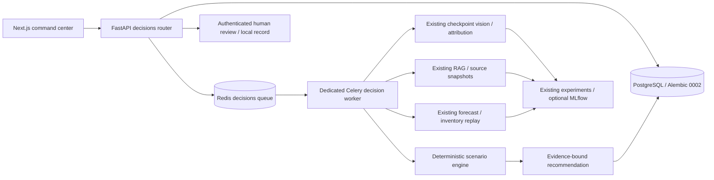

# Decision Intelligence Command Center

Open `/decision-intelligence` in the existing dashboard. This workspace connects operator-reported batch quality, registered vision inference, document retrieval, production forecasts, deterministic stock coverage, four scenario replays and authenticated human review. It does not execute equipment, procurement, ERP or schedule changes.

## Architecture and data flow



`automind.decision_api` handles bounded requests, image normalization, task dispatch and review authorization. `automind.decisions` orchestrates persisted stages and reuses the existing knowledge, vision, production and tracking modules. `automind.decision_simulation` is a pure daily replay. The frontend polls selected active jobs every 1.5 seconds and reads actual persisted stage events. Redis connectivity alone does not claim worker health.

The Celery worker imports its core decision dependencies before reporting ready, outside the ten-minute task execution limit. It does not load optional model weights or download models at startup.

Migration `0002` adds nine tables: `component_batches`, `decision_investigations`, `quality_observations`, `investigation_events`, `production_impact_assessments`, `decision_scenarios`, `decision_recommendations`, `decision_reviews`, `decision_audit_events`. Foreign keys retain existing component/dataset-version/model/forecast/evaluation links. It does not alter or delete the original sixteen application tables. Scenario runs and recommendations are retained as separate snapshots.

## Start and demonstrate

```powershell
python scripts/init-decision-reviewer.py
docker compose build api web
docker compose run --rm migrate
docker compose up -d api web decision-worker
```

The initializer preserves an existing valid reviewer configuration, writes only the token SHA256 and configured identity into ignored `.env`, and saves the raw local credential in ignored `runtime/decision-reviewer.txt`. Keep this file private. The script does not print the token. Existing credentials cannot be recovered from their hash; do not rotate them implicitly.

Select **Run synthetic demo**. This uses real seed-42 synthetic production data (240 days, three components), a clearly fictional indexed document and explicit synthetic inspection counts (40 inspected, 12 reported rejects). It dispatches an actual asynchronous analysis. No synthetic image classification or confidence is substituted for a missing model. The resulting case remains Draft until a person submits it for review.

For a custom investigation, choose an existing dataset version/component and declare the batch, inspected/rejected quantities and whether rejects are included in the recorded inventory. Attach an inspection image, select a registered checkpoint if available, and run analysis. These declarations are not verified against a manufacturing execution system.

## API

All paths below start at `/api/v1/decisions`. Existing API-key middleware, size limits and same-origin proxy continue to apply. Interactive schemas are in `/docs`.

| Method and path | Behavior |
| --- | --- |
| `GET /capabilities` | Reviewer configuration and execution boundary; no inferred worker liveness |
| `GET /investigations` | Latest 100 summaries, counts over all records, recent five Closed cases |
| `POST /investigations` | Create Draft with existing `version_id`, `component`, declared batch/quantities/severity |
| `POST /demo` | Create explicitly synthetic case and queue analysis |
| `GET /investigations/{id}` | Current evidence, stages, job, scenarios, recommendation, reviews and audit |
| `POST /investigations/{id}/image` | Multipart `file`; bounded upload, decoded/normalized PNG, checksums |
| `GET /investigations/{id}/image` | Associated image with no-store response |
| `POST /investigations/{id}/analyze` | Queue model/RAG/forecast/impact/scenario/recommendation work; returns 202 |
| `POST /investigations/{id}/simulate` | Replay four scenarios against current completed assessment; returns 202 |
| `GET /investigations/{id}/recommendations` | Current recommendation or null |
| `POST /investigations/{id}/submit` | Lock current completed evidence and enter Awaiting Review |
| `POST /{id}/review` | Authenticated approve/reject/close of exact recommendation/hash |

Analysis accepts `forecast_model` (`seasonal_naive`, `xgboost`, `lstm`), `horizon` (7–60), optional `model_id` and `explanation_mode` (`extractive`, `base`, `adapter`). Invalid vision model IDs fail validation; optional runtime failures are exposed. Review requires `X-Reviewer-ID` and `X-Review-Token`, plus `action`, `recommendation_id`, `evidence_hash`, 8–3000-character `comments` and `acknowledge_limitations: true`.

## Calculations and assumptions

The source inventory is the selected component’s final recorded dataset snapshot, with its original date. It is not assumed to describe today’s operations. Usable inventory equals recorded inventory minus operator-declared rejects only when the operator explicitly marks those rejects as included. Rejects cannot exceed inspected units; inspected units cannot exceed declared batch units. Included rejects cannot exceed the stock snapshot. One image prediction never determines reject counts.

Forecast demand is the sum of the existing model’s daily predictions. Potential shortage is `max(0, forecast demand − usable inventory)` with no inbound receipts assumed. Existing chronological evaluation and uncalibrated residual bands are retained. The assessment links its forecast and a stock-coverage evaluation/experiment; optional MLflow mirroring does not replace local metadata.

Every scenario uses the same forecast dates and original total demand:

- **A — usable inventory:** fulfill original due-date demand from usable stock.
- **B — reinspection:** assume `floor(rejected units × recovery_yield)` units arrive on the assumed reinspection day. This is hypothetical recovery, requiring successful inspection and separate release authorization.
- **C — replacement:** assume an arrival on `ceil(recorded supplier lead time) + additional delay`, with day zero the first forecast date. Default quantity is the ceiling of forecast shortfall, at least one; the operator can override it. Procurement cost is the assumed order commitment, including orders arriving after the horizon.
- **D — schedule adjustment:** shift release dates while retaining original due dates and total demand as the scoring reference. Deferred demand remains unserved or late, including demand beyond the horizon.

FIFO backlog is carried across days. Service is the fraction of **all original forecast demand fulfilled by its original due date**, not a measured SLA. End-of-day holding cost is stock × dataset unit cost × annual holding fraction / 365, summed across the horizon. Reinspection cost uses reported rejects × assumed per-unit cost. All costs use dataset currency; they are not realized savings. Supplier reliability is displayed in detailed evidence but does not become a stochastic delivery guarantee.

Estimated delay is outstanding-original-due units summed across days divided by total original demand. This is a censored lower bound on mean outstanding-unit days within the horizon; unresolved waits can be longer. “High shortage risk” means replay ends with unserved original demand; it is a deterministic category, not a probability.

For a zero-demand horizon, the engine defines service and fulfilled fractions as one and delay as zero because there is no unmet demand; this is a calculation convention, not measured operational performance.

Recommendation rule v1 ranks original-due-date service first, then fewer unserved units, then lower sum of declared holding/procurement/inspection costs. It is not capacity-constrained or economic optimization. It records supporting evidence, model outputs, assumptions, simulated impact, uncertainty, risks and alternatives. Requested LLM explanations use the existing configured local generation path, are labelled hypotheses, and cannot authorize anything. Default explanations are cited extracts. A requested generation failure is exposed while independently retrieved sources remain available.

## Review and security

`Draft → Awaiting Review → Approved or Rejected → Closed`. Analysis, image replacement and scenario changes are allowed only in Draft with no active job. Replacing evidence invalidates current downstream pointers; old records remain in history. Submission freezes evidence. Revisions require a new investigation.

Canonical evidence JSON is hashed with SHA256. Reviews must name the exact current recommendation and hash; stale or repeated transitions return 409. Reviewer identity is taken from server configuration after constant-time identity/token-hash comparison. Missing configuration fails closed with 503, missing credentials return 401, and incorrect credentials return 403. General API access does not grant review authority. The UI keeps the token in drawer memory only and requires comments and acknowledgement. No secret is stored in browser preferences.

Review rows and audit events include reviewer, time, recommendation/hash, status and comments. Every operational audit records `operational_action_performed: false`. Records are append-only through this application API, not tamper-proof against a database administrator. Image paths are generated, served only from the associated storage tree, and image metadata is stripped. Do not expose this local service publicly without TLS, proper identity/RBAC, credential management and the deployment controls documented in SECURITY.md. The local reviewer credential is a single authorized identity, not SSO or multiuser RBAC.

## Model dependencies and limits

No industrial checkpoint is shipped or silently downloaded. Vision needs a registered checkpoint plus the existing optional Torch/torchvision/safetensors runtime in the decision-worker image. An attached image without a usable checkpoint is explicitly unavailable, with no confidence number. Attribution is shown only when actual inference returns an artifact. The default lightweight image supports retrieval, seasonal-naive/XGBoost forecasting and scenario calculation; LSTM and LLM modes need documented optional dependencies/checkpoints.

Retrieved possible causes are quoted document possibilities with source indices, not verified root causes. Source text, chunk IDs and document checksums are retained in recommendation evidence. A document can itself be wrong or fictional; inspect its provenance. The demo handbook is explicitly unsuitable for operating real equipment.

Known limits: no live stock feed, capacity model, quality-release system, ERP adapter, stochastic supply simulation, or validated industrial decision policy. Hard-killing a worker can leave a job marked running; investigate its task ID and logs before recovery rather than dispatching duplicates. There is no automatic decision retry or operator cancellation endpoint. Queue workers run one decision at a time by default, with a ten-minute hard task limit. Audits and source snapshots are local, and this is a portfolio application rather than a production-certified control system.

## Verification

Focused tests cover quantity validation, four daily replays, fixed service denominator, nonfinite inputs, creation, actual RAG/forecast integration, recommendation snapshots, missing inference, image invalidation, scenario reruns, broker failures, reviewer authorization/transitions and audit records. Dedicated tests additionally exercise actual Redis/Celery transport and actual CPU checkpoint inference/attribution with random-weight synthetic software fixtures. Those fixtures establish wiring, not industrial accuracy.

Commands (optional dependencies and real services must be available):

```powershell
python -m pytest tests/unit/test_decision_simulation.py tests/integration/test_decisions.py -q
$env:SERVICE_REDIS_URL = 'redis://localhost:16379/14'
python -m pytest tests/integration/test_decision_worker.py tests/ml/test_decision_vision.py -q
python -m ruff check apps/api tests migrations
cd apps/web
npm run typecheck
npm run lint
npm run test:unit
```

### Executed verification — 25 October 2026

| Check | Observed result |
| --- | --- |
| Focused API and scenario tests | Initial 14 passed |
| Final backend regression (`tests/unit`, `tests/integration`, new CPU vision integration) | **47 passed, 1 skipped**, 299.34 seconds |
| Final targeted real Redis/training failure/vision/reviewer checks | **4 passed**, 43.45 seconds; overlaps the regression suite |
| Frontend unit checks | **8 passed** |
| Frontend TypeScript / ESLint | Passed; no ESLint warnings after using unoptimized Next Image for private associated artifacts |
| Python Ruff / configured mypy scope | Passed; mypy covers the existing config and shared schema files |
| Docker API and production web builds | Passed; no new application runtime dependencies |
| Existing PostgreSQL upgrade and `alembic check` | Head `0002`, no unintended schema operations; 25 application tables plus Alembic version table |
| Fresh temporary SQLite migration and `alembic check` | Both migrations applied; head `0002`, 25 application tables, no drift |
| Live readiness | PostgreSQL and Redis connected |

The skipped regression test requires `SERVICE_DATABASE_URL`; its PostgreSQL probe was not configured inside the disposable test image. The actual application PostgreSQL migration, schema comparison and readiness were verified separately. Real Redis delivery and actual CPU checkpoint inference/attribution did run. The checkpoint test uses random weights and two explicitly synthetic classes; it proves software integration, not industrial model quality. The test image also exercised the existing optional local MLflow SQLite mirror.

The first broad run had 45 passes, one skipped PostgreSQL check and one existing Redis test timeout while importing the training module under heavy local load. That transport test now preloads its optional module before its unchanged timed round trip, while still executing the real missing-dataset failure. Its targeted rerun and the full final regression passed. Temporary test databases used an in-memory Docker `/tmp`, with numerical-library thread counts set to one. Existing Starlette/httpx and NumPy timedelta deprecation warnings remain.

The first live synthetic task reached the configured soft timeout during cold dependency loading and recorded a failed job/stage. The worker startup import was moved ahead of readiness. Retrying the same case after attaching a clearly synthetic checker-pattern software image completed in **1.13 seconds** on the warmed local worker; this single observation is not a performance benchmark. The original failure remains in the case timeline and audit.

Browser verification used the actual Next.js/FastAPI/PostgreSQL/Redis/Celery deployment at ports 13000/18000. It covered the labelled synthetic demo, persisted execution states, unavailable vision without invented confidence, a normalized image upload, invalidation of older assessments/recommendations, cited passages and hypotheses, stock coverage, four scenario cards, editable replay and review submission. Changing recovery to 0.5, additional delivery delay to two days and replacement quantity to 1,400 produced new persisted outcomes and a new recommendation/hash. The example retained 48 usable units against 1,322 forecast units and a calculated 1,274-unit shortfall; these are synthetic dataset values, not current manufacturing stock.

The example case is left **Awaiting Review**, with no reviewer decision and no operational action. The drawer has a password token field, required comments/acknowledgement, and a disabled approval button until its acknowledgement is supplied; server-side authentication and transition checks remain authoritative. Stage inspectors and the review drawer were checked on mobile, including Escape dismissal and restored focus. Layouts at 1440, 768 and 390 pixels showed no page overflow. Dark and light themes were inspected, and scenario colors use the shared theme tokens. Screenshots are in `docs/screenshots/decision-intelligence/`.

During final handoff, Docker Desktop's Linux engine returned internal errors for its container-list and `_ping` endpoints while Desktop itself still reported running, and both application ports timed out. The user authorized restarting Docker Desktop, which recovered the engine (server 29.8.2, API 1.56). AutoMind's API, web, decision worker, PostgreSQL and Redis services restarted successfully. API readiness, the web route and the saved inspection image returned HTTP 200. The persisted synthetic case retained its completed analysis, four scenarios, evidence hash and Awaiting Review status, with zero reviewer decisions and every audit recording no operational action. The refreshed browser showed the system operational; `desktop-complete.jpg` and `desktop-evidence.jpg` capture this recovered state. Temporary viewport overrides were reset after responsive verification.

`tests/e2e/decision-intelligence.spec.ts` provides the repeatable Playwright browser workflow. The equivalent walkthrough above was executed through the browser tool; the standalone Playwright CLI was not run in this Windows environment. To run it against the local Docker app with Playwright browsers installed:

```powershell
cd apps/web
$env:E2E_BASE_URL = 'http://localhost:13000'
npm run test:e2e -- decision-intelligence.spec.ts
```
